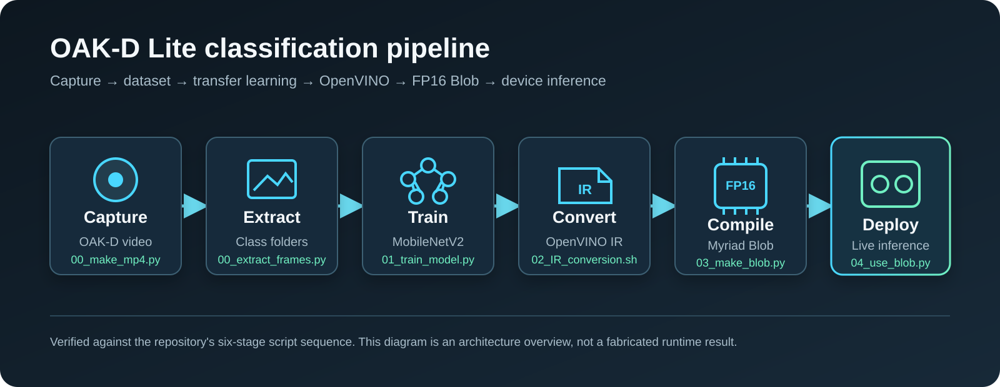

# OAK-D Lite Real-Time Image Classification Pipeline

An end-to-end reference pipeline that records camera data, prepares an image dataset, trains a TensorFlow classifier, converts the model through OpenVINO, and runs real-time inference on an OAK-D Lite.

The checked-in example is configured as a two-class orientation classifier (`LAT` and `PA`). The same pipeline can be adapted to other classes by changing the dataset folders, output layer, and inference labels.

## Pipeline overview



The diagram follows the checked-in script sequence. It is an architecture overview; it does not represent a fabricated device result or accuracy claim.

## What this project demonstrates

- Camera capture and video recording with DepthAI and OpenCV
- Repeatable frame extraction into class-based dataset folders
- Transfer learning with a frozen MobileNetV2 backbone
- TensorFlow SavedModel export
- OpenVINO IR conversion with NHWC-to-NCHW layout conversion
- FP16 Blob generation for Myriad/OAK-D deployment
- On-device neural-network execution with live label and confidence overlay

## Repository layout

| File | Purpose |
| --- | --- |
| `00_make_mp4.py` | Record a 300×300, 30 FPS MP4 stream from the OAK-D Lite |
| `00_extract_frames.py` | Extract frames into a class directory |
| `01_train_model.py` | Build, train, evaluate, and export the classifier |
| `02_IR_conversion.sh` | Convert the SavedModel to OpenVINO IR |
| `03_make_blob.py` | Convert IR files to an FP16 Blob |
| `04_use_blob.py` | Run real-time inference on the OAK-D Lite |

## Model configuration

- Input: `224 × 224 × 3`
- Backbone: MobileNetV2 with ImageNet weights
- Backbone training: frozen
- Classification head: global average pooling and dense/dropout layers
- Dataset split: 80% training / 20% validation
- Batch size: 32
- Training: up to 20 epochs with early stopping on validation loss
- Example output: two classes

## Dataset layout

TensorFlow infers class labels from directory names.

```text
bodyparts/
├─ LAT/
│  ├─ LAT_0001.jpg
│  └─ ...
└─ PA/
   ├─ PA_0001.jpg
   └─ ...
```

The dataset, trained model, and generated output files are intentionally excluded from version control.

## Run order

1. Set the recording and class names in the scripts.
2. Record sample videos with `00_make_mp4.py`.
3. Extract frames with `00_extract_frames.py`.
4. Train and export the model with `01_train_model.py`.
5. Convert the SavedModel with `02_IR_conversion.sh`.
6. Generate the device Blob with `03_make_blob.py`.
7. Run live inference with `04_use_blob.py`.

## Dependencies

- Python 3
- OpenCV
- DepthAI SDK
- TensorFlow
- OpenVINO Model Optimizer
- blobconverter
- NumPy
- Matplotlib

## Compatibility note

The current conversion scripts target the legacy OpenVINO Model Optimizer flow and an OpenVINO 2022.1 Blob. OpenVINO and DepthAI version compatibility should be checked before reproducing the pipeline with newer toolchains.

## Limitations

- File paths and class names are currently configured in the scripts.
- Model quality depends on dataset size, diversity, lighting, and camera position.
- Trained weights, benchmark results, and a current hardware-output capture are not included, so this repository does not claim a fixed accuracy or present an unverified inference screenshot.
- This is a research and portfolio prototype, not a certified clinical system.

## Privacy

Use only consented, de-identified, synthetic, or openly licensed images. Do not commit personal or clinical image data.
